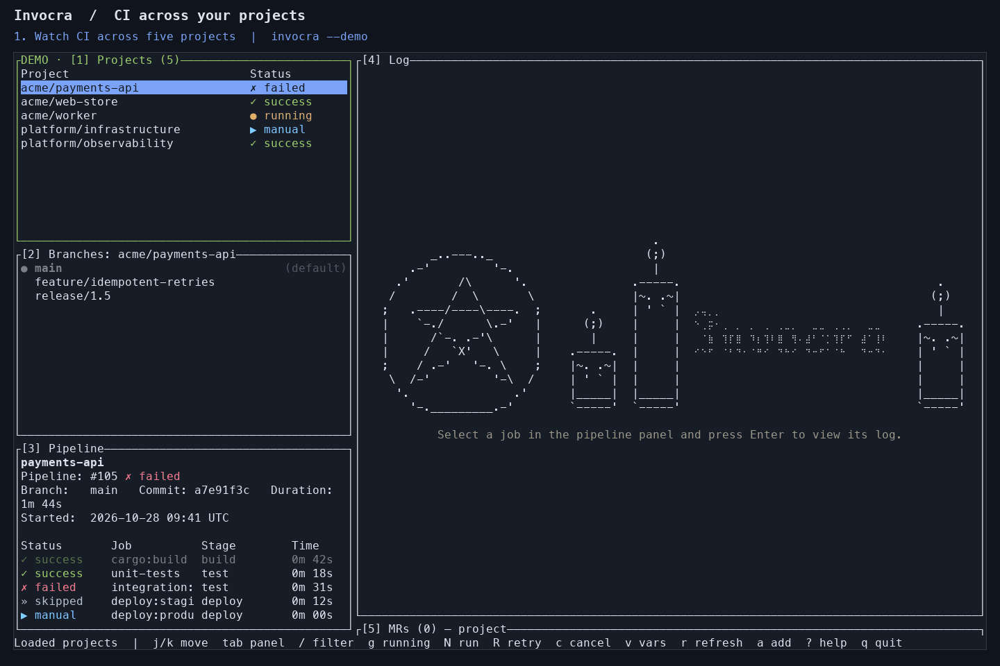
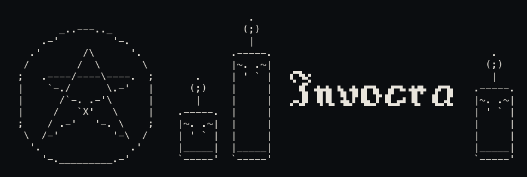

# Invocra

A lazygit-style terminal dashboard for GitLab™ CI — watch pipelines across projects, read logs and retry jobs without leaving the terminal.



Try it without a GitLab account: `invocra --demo`

```bash
brew install dsszs3333/tap/invocra
```

Keep several projects in view, follow a different branch in each, inspect job logs
and retry failed builds. No repository checkout needed.

Built with the help of AI.

## Demo

Run `invocra --demo` to explore the dashboard using built-in sample GitLab data.

Watch CI across projects, pin a branch, open a failed job's log, search with `/`,
then select the failed job in the pipeline pane, press `R` and confirm to simulate
a retry. Demo actions only show a status message; sample data stays unchanged and
no new run is created.

## Features

- **Project and group dashboard**: static `[[project]]` entries plus `[[group]]` — group projects are pulled in automatically on every refresh (new projects show up on their own)
- **Per-project branch selection**: a branches pane under the project list; by default the dashboard follows the repository's default branch, `enter` pins another (`u` to unpin), and status and pipeline update for the selected ref. The choice persists across runs
- **Pipeline actions**: retry a failed pipeline/job, cancel a running one, play manual jobs — all behind a confirm dialog
- **Job logs**: scrollable viewer; running jobs get a follow mode (like `less +F`, refreshing every 3–15s as output changes, within the instance request budget)
- **CI/CD variables**: read-only view, values masked until explicitly revealed (requires the Maintainer role)
- **lazygit UI**: five panes (projects, branches, pipeline/jobs, log, merge requests), focus via `tab` or `1`–`5`, filter `/`, help `?`, hotkey bar at the bottom
- **Pipeline history and downstreams**: inspect previous pipelines and follow bridge jobs into their downstream project
- **Merge requests**: project/created/assigned lists, head pipelines, approval and merge with reviewed-SHA confirmation
- **Environments, tags and artifacts**: browse deployments, create tags and download job archives
- **Offline cache**: last-known data is shown when the network is unavailable
- Token is stored in the OS keyring (or in `INVOCRA_GITLAB_TOKEN`)

## Installation

`invocra --demo` — try it without a GitLab account.

Source repository: [dsszs3333/invocra](https://github.com/dsszs3333/invocra).

### Homebrew (macOS and Linux)

```bash
brew install dsszs3333/tap/invocra
invocra --version
```

The public [Homebrew tap](https://github.com/dsszs3333/homebrew-tap) builds v0.2.2
from source. Homebrew installs Rust as a build dependency; installation can take several minutes.

To update an existing installation:

```bash
brew update
brew upgrade dsszs3333/tap/invocra
```

### Linux x86_64 release

Download [v0.3.0](https://github.com/dsszs3333/invocra/releases/tag/v0.3.0), verify the checksum and install the binary:

```bash
mkdir -p invocra-download
cd invocra-download
curl -fLO https://github.com/dsszs3333/invocra/releases/download/v0.3.0/invocra-v0.3.0-x86_64-unknown-linux-gnu.tar.gz
curl -fLO https://github.com/dsszs3333/invocra/releases/download/v0.3.0/SHA256SUMS
sha256sum --check SHA256SUMS
tar -xzf invocra-v0.3.0-x86_64-unknown-linux-gnu.tar.gz
install -Dm755 invocra "$HOME/.local/bin/invocra"
"$HOME/.local/bin/invocra" --version
```

Ensure `~/.local/bin` is on your `PATH`. This archive requires Linux x86_64 and glibc 2.39 or newer. On macOS, Linux ARM64, or systems with older glibc, use the pinned source installation below.

### crates.io (Rust 1.88 or newer)

```bash
cargo install invocra --locked
invocra --version
```

### From a pinned Git tag (Rust 1.88 or newer)

```bash
cargo install --git https://github.com/dsszs3333/invocra.git --tag v0.3.0 --locked invocra
invocra --version
```

### Local source build (Rust 1.88 or newer)

```bash
cargo install --path crates/app --locked
# or build without installing:
cargo build --release --locked -p invocra
./target/release/invocra --help
```

## Quick start

Just run it — on first launch a setup wizard opens right in the interface:

```bash
invocra
```

A three-step wizard: **(1)** GitLab URL → **(2)** Personal Access Token (scope `api`, stored in the keyring) → **(3)** select groups and projects (multi-select, `tab` switches lists, `/` filters). After that the dashboard opens immediately and your selection is written to the config.

Alternatively, configure via the CLI:

```bash
invocra setup             # run or retry interactive setup
invocra auth login        # save the token
invocra config discover   # select projects
invocra doctor            # check config, token, and API access
```

On Linux, `linux-native` stores credentials in the kernel keyring: they do not survive
reboot and can expire with the session. Re-run `invocra auth login --url <url>`;
a missing token does not replace your saved projects or open setup automatically.
macOS uses Keychain; Windows uses Credential Manager.

The token can also be supplied via an environment variable (handy on servers and on Linux without a keyring):

```bash
export INVOCRA_GITLAB_TOKEN=glpat-...
```

## Configuration

`~/.config/invocra/projects.toml` — one or more GitLab instances:

```toml
[[instance]]
url = "https://gitlab.com"

# All projects in a group (by path or numeric id).
[[instance.group]]
path = "my-org/backend"
include_subgroups = true

[[instance.group]]
id = 12345

# Individual projects.
[[instance.project]]
name = "other-org/tool"
id = 67890

# A second instance — switch between them in the dashboard with [ and ].
[[instance]]
url = "https://git.corp"

[[instance.project]]
name = "team/infra"
id = 42

# Global settings (optional).
[settings]
# Audible beep + desktop notification when a watched pipeline finishes. Defaults to true.
notifications = true
```

Duplicates (a project listed both in a group and in `[[instance.project]]`) are collapsed; the name comes from `[[instance.project]]`.
Instances can be added on first run (the wizard asks "add another?") or later straight from the dashboard with the `a` key. The token is stored in the keyring per instance; the CLI alternative is
`invocra auth login --url <url>` (with a single instance, `--url` can be omitted).

Tokens saved by older versions under a single global keyring account must be saved
again with `invocra auth login --url <url>`. They are never reused automatically
for another instance.

The old flat format (`gitlab_url` + top-level `[[project]]`/`[[group]]`) is still read as a single instance.

### Request limits and manual refresh

Configure these in `~/.config/invocra/projects.toml`, then restart Invocra.
The TUI displays the effective mode, budget and whether each value comes from an
instance override or the defaults. It does not edit these settings.

```toml
[settings]
requests_per_minute = 80
auto_refresh = true

[[instance]]
url = "https://git.example.com"
requests_per_minute = 100
# Add this instance's [[instance.project]] / [[instance.group]] blocks here.

[[instance]]
url = "https://git.internal.example.com"
requests_per_minute = "unlimited"
auto_refresh = false
# Add this instance's projects / groups here.
```

Merge these fields into your existing tables; do not create a second `[settings]`
table. Both fields can be set globally and overridden independently per instance.
Omitted fields inherit the global value; built-in defaults are **80 requests/minute**
and **automatic refresh**. A limit must be a positive integer; `"unlimited"` explicitly
removes a local cap, including an inherited one. `0` does not mean unlimited.

Each instance has its own budget and cooldown. All requests to GitLab share it,
including list pages, logs, actions and artifact requests. Requests are paced rather
than sent in a burst; queued interactive requests take priority over automatic polling.
Within automatic polling, the pipeline currently displayed gets up to two request slots
before one slot goes to other active projects waiting for budget. This applies to latest,
historical, downstream and MR pipelines. Navigation replaces queued polls at the new priority;
manual actions are preserved. The other active projects continue updating in the background.
With many active projects, updates therefore take longer. Background refresh reuses
project metadata; an explicit dashboard refresh retrieves it again. Hidden projects keep polling
the latest pipeline status but reload jobs and downstream details every 30 seconds. A changed
pipeline ID/status or terminal result triggers a full detail fetch immediately. In automatic mode,
opening a project reloads details after the selection stays stable for 300 ms, unless they were
updated within the last three seconds. Moving again cancels that navigation fetch; it uses automatic
priority and cannot spend the manual quota reserve. Manual refresh, actions and the `g`
running-pipeline scan load full details. Full dashboard refreshes show each project's snapshot as it
arrives; loaded active projects can resume polling while the remaining projects load. A full refresh
loads up to two projects at once with a local budget, or eight without one. Hidden inspected
history/downstream/MR views refresh every 30 seconds; the open view keeps its normal polling.

`auto_refresh = false` stops periodic status and log polling, including `f` follow,
and automatic detail refreshes on project selection. Initial loading, explicitly opening
logs/history/other panels, explicit actions and their result refreshes still make requests. Use `r` to refresh the dashboard or, with log focus, the open log.
Manual requests obey the configured budget too. Put `auto_refresh = false` under
`[settings]` to use manual mode everywhere, unless an instance overrides it.

On HTTP 429, Invocra pauses new requests to that instance for `Retry-After`
(or backs off if it is absent), even with an unlimited local budget. Server-directed waits
are capped at 24 hours to prevent unreasonable headers from indefinitely blocking an instance.
The TUI shows a hint to reduce `requests_per_minute` or use manual mode; it clears after a
successful response following the cooldown. Settings apply on startup; cooldowns live only in
memory and a restart clears them. GET requests retry once; mutating actions are never
automatically retried.

When valid `RateLimit-Remaining` and `RateLimit-Reset` headers are available, automatic
polling spreads the remaining quota over the time until reset. It reserves 10% of the first
reported remaining quota in each window (at least one request) for manual requests. Manual
requests can use that reserve but still obey the local budget, exhausted server quota and
429 pauses. This server pacing also applies with `"unlimited"`.

Within a quota window, later responses can only lower the estimated remaining quota.
Invocra accounts conservatively for requests still in flight and reacts to quota consumed
by other clients when a response reports it. A newer reset timestamp starts a new window;
expired windows and delayed responses from older windows do not prolong waiting. Missing
or invalid headers leave the current estimate unchanged; without a valid estimate, only
the local budget and 429 handling apply. When available, the server's `Date` header supplies
the clock for reset timestamps and HTTP-date `Retry-After` values. Reset windows longer
than 24 hours are treated as invalid headers. CDN redirects do not affect the GitLab estimate.

The budget covers one running Invocra process, not other clients sharing your GitLab
user/IP quota. Leave headroom below your server's limit; a 429 does not necessarily
mean your configuration is wrong. The footer's update age refers to the selected
project's successful snapshot refresh in this session, not to every row or log.

## Hotkeys

| Key | Action |
|---|---|
| `tab`, `1`–`5` | cycle / select pane |
| `h`/`←`, `l`/`→` | focus projects / log |
| `+` / `_` | expand the focused pane to full screen / collapse |
| `j`/`k`, `↓`/`↑` | cursor: projects / jobs |
| `enter` | open the pipeline pane; on a job — its log |
| `x` | action menu for the job/pipeline under the cursor |
| `/` | filter projects (`esc` to clear) |
| `r` | refresh projects and reset the MR list; with log focus, refresh the log once |
| `g` | find projects with running pipelines (outside log focus) |
| `u` | unpin the selected branch |
| `P` | pipeline history (latest 20) |
| `5`, then `m` | MR panel / cycle project, created, assigned scopes (latest 50) |
| `N` | run a pipeline on the selected ref |
| `e` | environments and deployments |
| `T` | tags (`n` creates a tag) |
| `o` | open the selected item in the browser |
| `[` / `]` | switch the GitLab instance tab |
| `a` | add a new instance (wizard) |
| `R` | retry: pipeline (in the projects pane) / job (in the pipeline pane) |
| `c` | cancel a running pipeline |
| `p` | play a manual job |
| `L` | log of the selected job (`f` follow, `g`/`G` top/bottom, `PgUp`/`PgDn`) |
| `v` | CI/CD variables (`s` reveals the selected value) |
| `?` | help |
| `q` | quit |

Pipeline/job and MR mutations require confirmation and a suitable status. Tag creation uses an explicit form.
Artifacts are available from the selected job’s `x` action menu and are saved to Downloads.
The `x` menu gathers the available actions in one list (inapplicable ones are greyed out with a reason). While an
action is running, a spinner spins next to the row. When a watched pipeline finishes, a beep sounds and a
desktop notification arrives (disable via `[settings] notifications = false`).

## Token permissions

HTTPS connections use the operating system's trusted root certificates. For a private
GitLab instance, install your organization's CA certificate in that trust store.
On Linux, make sure the system CA bundle is installed (usually the `ca-certificates`
package). Certificate and hostname verification remain enabled.

- Scope `api` is required for write actions (pipeline/job control, tags, MR approval/merge). If you only
  want to **view** dashboards and never trigger actions, `read_api` is enough.
- Viewing variables requires the **Maintainer** role in the project; otherwise you get a clear 403 placeholder.
- Prefer a token with a short **expiration**, and revoke it in GitLab if it leaks.
  For single-project use, a **project access token** limits the blast radius to that
  project instead of your whole account.
- The token is sent only to the GitLab instance you configure, over HTTPS, and is
  never forwarded to another origin. Artifact downloads can follow HTTPS CDN
  redirects without the token. See [SECURITY.md](SECURITY.md).

## Building from source

```bash
cargo build --release --locked # binary: target/release/invocra
cargo test --workspace --locked
cargo clippy --workspace --all-targets --all-features --locked -- -D warnings
```

## Cache and architecture

A workspace of five crates: `app` (CLI/entry point, package `invocra`), `tui` (panes, input, actions; package `invocra-tui`), `gitlab` (REST client, `invocra-gitlab`), `config` (TOML config, `invocra-config`), `storage` (keyring + offline cache, `invocra-storage`). See `ARCHITECTURE.md` for details.

Dashboard caches are bound to each GitLab URL (ignoring surrounding whitespace and trailing slashes),
with that URL verified inside the saved file. Reordering instance tabs keeps the same cache.
Old `dashboard-cache.json` and slug-based caches are left untouched and are not loaded automatically:
they do not identify their server reliably. Existing pins in those files require manual recovery
after checking which server they belong to; the dashboard creates a fresh cache on its next refresh.

The cache contains only snapshots and ref pins. Logs, variables, branches and MR lists still
need the API; offline mode cannot perform actions. `INVOCRA_GITLAB_TOKEN` applies to all configured
instances, so use URL-specific keyring entries when servers need different credentials.

The 85×13 ritual composition appears above the first-run setup fields and in the empty log panel.
Press `4`, then `+` to expand the log panel. Smaller areas show only the 28×4 Gothic wordmark;
if that cannot fit either, they show a plain Invocra title. The drawing never wraps or renders
partially, and uses the terminal's default foreground and background colors.

The [terminal composition](crates/tui/src/render/invocra.txt) preserves the supplied ASCII pentacle
and three candles. Its wordmark encodes the Terminal Gothic bitmap glyphs as Unicode Braille cells,
so it uses the terminal's own font and requires Braille glyph support. No TTF is loaded by the app.



## Credits

The README banner and TUI wordmark use [Terminal Gothic](https://littlebitspace.com/resources/#TerminalGothic)
by [littlebitspace](https://littlebitspace.com/). The TUI adapts its bitmap glyphs into Unicode Braille cells.

## Trademarks

Invocra is an independent project and is not affiliated with, endorsed, sponsored,
or approved by GitLab Inc. GITLAB is a trademark of GitLab Inc. in the United States
and other countries and regions.
