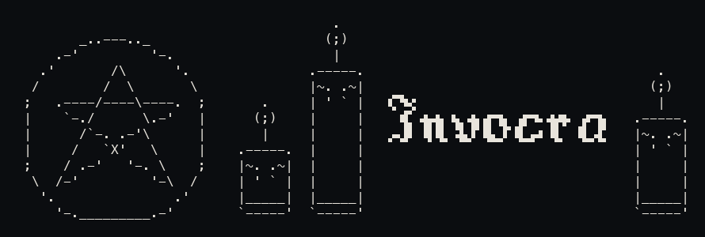
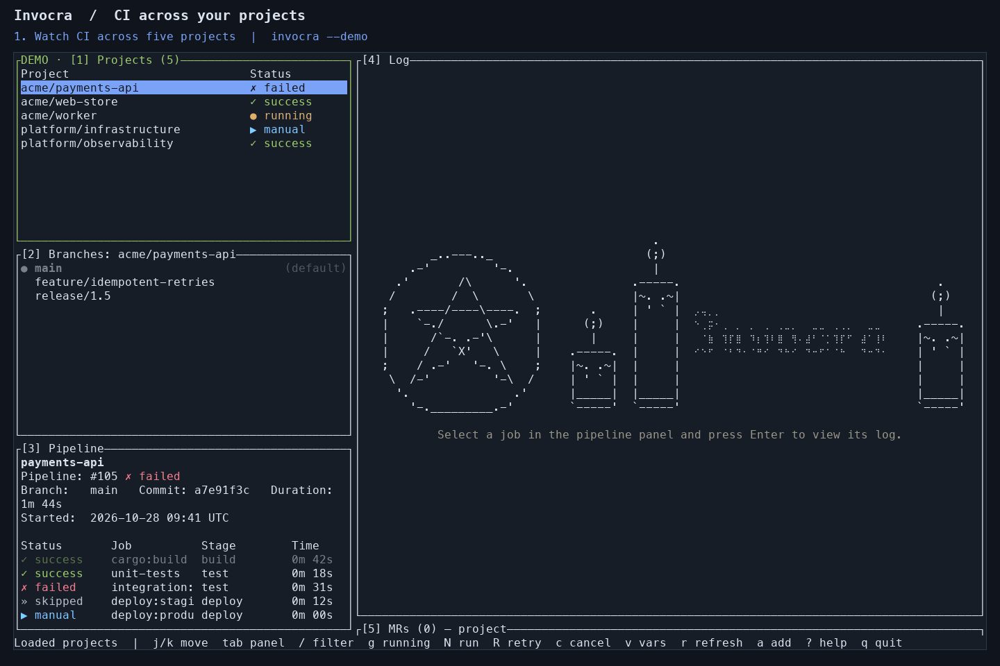

# Invocra



A terminal dashboard for GitLab™ CI across projects and servers. Keep several
projects in view, follow a different branch in each, inspect job logs and retry
failed builds without leaving the terminal. No repository checkout needed.

Built with the help of AI.

Install with [Homebrew](#homebrew-macos-and-linux):

```bash
brew install dsszs3333/tap/invocra
```

## Demo



Recorded from Invocra's interactive dashboard using sample GitLab data.

Watch CI across projects, pin a branch, open a failed job's log, search with `/`,
then press `R` and confirm to retry. Inspect the new run in the same dashboard.

## Features

- **Project and group dashboard**: static `[[project]]` entries plus `[[group]]` — group projects are pulled in automatically on every refresh (new projects show up on their own)
- **Per-project branch selection**: a branches pane under the project list; by default the dashboard follows the repository's default branch, `enter` pins another (`u` to unpin), and status and pipeline update for the selected ref. The choice persists across runs
- **Pipeline actions**: retry a failed pipeline/job, cancel a running one, play manual jobs — all behind a confirm dialog
- **Job logs**: scrollable viewer; running jobs get a follow mode (like `less +F`, refreshing every 1s)
- **CI/CD variables**: read-only view, values masked until explicitly revealed (requires the Maintainer role)
- **lazygit UI**: five panes (projects, branches, pipeline/jobs, log, merge requests), focus via `tab` or `1`–`5`, filter `/`, help `?`, hotkey bar at the bottom
- **Pipeline history and downstreams**: inspect previous pipelines and follow bridge jobs into their downstream project
- **Merge requests**: project/created/assigned lists, head pipelines, approval and merge with reviewed-SHA confirmation
- **Environments, tags and artifacts**: browse deployments, create tags and download job archives
- **Offline cache**: last-known data is shown when the network is unavailable
- Token is stored in the OS keyring (or in `INVOCRA_GITLAB_TOKEN`)

## Installation

Source repository: [dsszs3333/invocra](https://github.com/dsszs3333/invocra).

### Homebrew (macOS and Linux)

```bash
brew install dsszs3333/tap/invocra
invocra --version
```

The public [Homebrew tap](https://github.com/dsszs3333/homebrew-tap) builds v0.1.0
from source. Homebrew installs Rust as a build dependency; installation can take several minutes.

To update an existing installation:

```bash
brew update
brew upgrade dsszs3333/tap/invocra
```

### Linux x86_64 release

Download [v0.1.0](https://github.com/dsszs3333/invocra/releases/tag/v0.1.0), verify the checksum and install the binary:

```bash
mkdir -p invocra-download
cd invocra-download
curl -fLO https://github.com/dsszs3333/invocra/releases/download/v0.1.0/invocra-v0.1.0-x86_64-unknown-linux-gnu.tar.gz
curl -fLO https://github.com/dsszs3333/invocra/releases/download/v0.1.0/SHA256SUMS
sha256sum --check SHA256SUMS
tar -xzf invocra-v0.1.0-x86_64-unknown-linux-gnu.tar.gz
install -Dm755 invocra "$HOME/.local/bin/invocra"
"$HOME/.local/bin/invocra" --version
```

Ensure `~/.local/bin` is on your `PATH`. This archive requires Linux x86_64 and glibc 2.39 or newer. On macOS, Linux ARM64, or systems with older glibc, use the pinned source installation below.

### From a pinned Git tag (Rust 1.88 or newer)

```bash
cargo install --git https://github.com/dsszs3333/invocra.git --tag v0.1.0 --locked invocra
invocra --version
```

### Local source build (Rust 1.88 or newer)

```bash
cargo install --path crates/app --locked
# or build without installing:
cargo build --release --locked -p invocra
./target/release/invocra --help
```

## Quick start

Just run it — on first launch a setup wizard opens right in the interface:

```bash
invocra
```

A three-step wizard: **(1)** GitLab URL → **(2)** Personal Access Token (scope `api`, stored in the keyring) → **(3)** select groups and projects (multi-select, `tab` switches lists, `/` filters). After that the dashboard opens immediately and your selection is written to the config.

Alternatively, configure via the CLI:

```bash
invocra setup             # run or retry interactive setup
invocra auth login        # save the token
invocra config discover   # select projects
invocra doctor            # check config, token, and API access
```

On Linux, `linux-native` stores credentials in the kernel keyring: they do not survive
reboot and can expire with the session. Re-run `invocra auth login --url <url>`;
a missing token does not replace your saved projects or open setup automatically.
macOS uses Keychain; Windows uses Credential Manager.

The token can also be supplied via an environment variable (handy on servers and on Linux without a keyring):

```bash
export INVOCRA_GITLAB_TOKEN=glpat-...
```

## Configuration

`~/.config/invocra/projects.toml` — one or more GitLab instances:

```toml
[[instance]]
url = "https://gitlab.com"

# All projects in a group (by path or numeric id).
[[instance.group]]
path = "my-org/backend"
include_subgroups = true

[[instance.group]]
id = 12345

# Individual projects.
[[instance.project]]
name = "other-org/tool"
id = 67890

# A second instance — switch between them in the dashboard with [ and ].
[[instance]]
url = "https://git.corp"

[[instance.project]]
name = "team/infra"
id = 42

# Global settings (optional).
[settings]
# Audible beep + desktop notification when a watched pipeline finishes. Defaults to true.
notifications = true
```

Duplicates (a project listed both in a group and in `[[instance.project]]`) are collapsed; the name comes from `[[instance.project]]`.
Instances can be added on first run (the wizard asks "add another?") or later straight from the dashboard with the `a` key. The token is stored in the keyring per instance; the CLI alternative is
`invocra auth login --url <url>` (with a single instance, `--url` can be omitted).

Tokens saved by older versions under a single global keyring account must be saved
again with `invocra auth login --url <url>`. They are never reused automatically
for another instance.

The old flat format (`gitlab_url` + top-level `[[project]]`/`[[group]]`) is still read as a single instance.

## Hotkeys

| Key | Action |
|---|---|
| `tab`, `1`–`5` | cycle / select pane |
| `h`/`←`, `l`/`→` | focus projects / log |
| `+` / `_` | expand the focused pane to full screen / collapse |
| `j`/`k`, `↓`/`↑` | cursor: projects / jobs |
| `enter` | open the pipeline pane; on a job — its log |
| `x` | action menu for the job/pipeline under the cursor |
| `/` | filter projects (`esc` to clear) |
| `r` | refresh projects and reset the MR list |
| `g` | find projects with running pipelines (outside log focus) |
| `u` | unpin the selected branch |
| `P` | pipeline history (latest 20) |
| `5`, then `m` | MR panel / cycle project, created, assigned scopes (latest 50) |
| `N` | run a pipeline on the selected ref |
| `e` | environments and deployments |
| `T` | tags (`n` creates a tag) |
| `o` | open the selected item in the browser |
| `[` / `]` | switch the GitLab instance tab |
| `a` | add a new instance (wizard) |
| `R` | retry: pipeline (in the projects pane) / job (in the pipeline pane) |
| `c` | cancel a running pipeline |
| `p` | play a manual job |
| `L` | log of the selected job (`f` follow, `g`/`G` top/bottom, `PgUp`/`PgDn`) |
| `v` | CI/CD variables (`s` reveals the selected value) |
| `?` | help |
| `q` | quit |

Pipeline/job and MR mutations require confirmation and a suitable status. Tag creation uses an explicit form.
Artifacts are available from the selected job’s `x` action menu and are saved to Downloads.
The `x` menu gathers the available actions in one list (inapplicable ones are greyed out with a reason). While an
action is running, a spinner spins next to the row. When a watched pipeline finishes, a beep sounds and a
desktop notification arrives (disable via `[settings] notifications = false`).

## Token permissions

- Scope `api` is required for write actions (pipeline/job control, tags, MR approval/merge). If you only
  want to **view** dashboards and never trigger actions, `read_api` is enough.
- Viewing variables requires the **Maintainer** role in the project; otherwise you get a clear 403 placeholder.
- Prefer a token with a short **expiration**, and revoke it in GitLab if it leaks.
  For single-project use, a **project access token** limits the blast radius to that
  project instead of your whole account.
- The token is sent only to the GitLab instance you configure, over HTTPS, and is
  never forwarded to another origin. Artifact downloads can follow HTTPS CDN
  redirects without the token. See [SECURITY.md](SECURITY.md).

## Building from source

```bash
cargo build --release --locked # binary: target/release/invocra
cargo test --workspace --locked
cargo clippy --workspace --all-targets --all-features --locked -- -D warnings
```

## Cache and architecture

A workspace of five crates: `app` (CLI/entry point, package `invocra`), `tui` (panes, input, actions; package `invocra-tui`), `gitlab` (REST client, `invocra-gitlab`), `config` (TOML config, `invocra-config`), `storage` (keyring + offline cache, `invocra-storage`). See `ARCHITECTURE.md` for details.

Dashboard caches are bound to each GitLab URL (ignoring surrounding whitespace and trailing slashes),
with that URL verified inside the saved file. Reordering instance tabs keeps the same cache.
Old `dashboard-cache.json` and slug-based caches are left untouched and are not loaded automatically:
they do not identify their server reliably. Existing pins in those files require manual recovery
after checking which server they belong to; the dashboard creates a fresh cache on its next refresh.

The cache contains only snapshots and ref pins. Logs, variables, branches and MR lists still
need the API; offline mode cannot perform actions. `INVOCRA_GITLAB_TOKEN` applies to all configured
instances, so use URL-specific keyring entries when servers need different credentials.

The 85×13 ritual composition appears above the first-run setup fields and in the empty log panel.
Press `4`, then `+` to expand the log panel. If the available area is too small, only the compact
Invocra title is shown; the drawing never wraps or renders partially.

The [terminal composition](crates/tui/src/render/invocra.txt) preserves the supplied ASCII pentacle
and three candles. Its wordmark encodes the Terminal Gothic bitmap glyphs as Unicode Braille cells,
so it uses the terminal's own font and requires Braille glyph support. No TTF is loaded by the app.

## Trademarks

Invocra is an independent project and is not affiliated with, endorsed, sponsored,
or approved by GitLab Inc. GITLAB is a trademark of GitLab Inc. in the United States
and other countries and regions.
